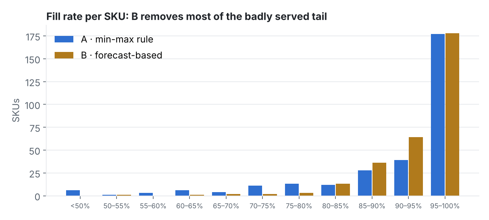
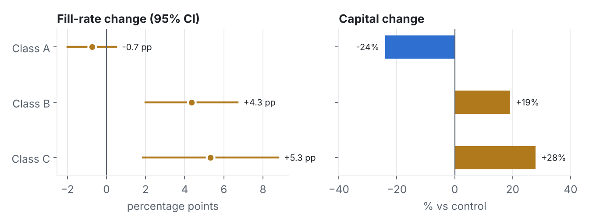

**English** · [Português](README.pt-BR.md)

# A/B test: two replenishment policies for a medical-device catalog

Does a forecast-based reorder policy serve hospitals better than the min-max rule most distributors still use, without tying up more cash in stock? I set this up the way I would run it at a real OPME (orthopedic implants and surgical materials) distributor: randomize SKUs, fix the metrics before looking, check the pipeline with an A/A test, then read the result with more than one test.

> **The data is synthetic.** The catalog and demand are generated with a fixed seed so anyone can rerun the exact numbers below. The demand shape mimics what implant distributors see: most items sell a few times a month, in irregular lots. No client data was used.

## The question, in business terms

A distributor carries 600 SKUs. Today every item follows a **min-max rule** (policy A): when stock plus open orders drops to the minimum, buy up to twice the minimum. The minimum was set once, from past average demand.

The proposal is a **forecast-based order-up-to policy** (policy B): review every item weekly, forecast demand with Croston-SBA (built for intermittent demand), and order up to the level that covers lead time plus one week at a target service level (95% for A and B items, 90% for C).

The decision rule was written before the run:

| Role | Metric | Pass condition |
|---|---|---|
| Primary | Fill rate per SKU (units served / units demanded) | B better than A, 95% CI above zero |
| Guardrail | Average capital tied up in stock | B no more than 10% above A (upper CI bound ≤ 1.10) |
| Secondary | Orders placed, stockout days | Reported with Holm correction |
| Minimum effect worth acting on | | +3 percentage points of fill rate |

## Design

- **Unit of randomization:** the SKU. 600 SKUs, split 300 / 300, stratified by ABC class so both arms carry the same mix of high- and low-value items (A 194, B 178, C 228).
- **Timeline:** 90-day pre-period where every SKU runs policy A (the first 30 days are dropped as warm-up), then 182 days of test.
- **Demand:** daily Bernoulli occurrence × gamma-distributed lot size. By the Syntetos-Boylan classification the catalog is 309 intermittent, 276 lumpy, 8 erratic and 7 smooth SKUs. Unmet demand is lost (a hospital buys from a competitor).
- **Sample size:** the pre-registered effect of 3 pp with a standard deviation of 0.10 needs 181 SKUs per arm for 80% power at α = 5%. The test has 300.
- **Pipeline check (A/A test):** 200 runs where both arms get policy A. A correct pipeline flags about 5% of them as significant by chance. Observed: **3.5%**.

## Results

| | A · min-max | B · forecast | Difference (95% CI) | p |
|---|---|---|---|---|
| Fill rate, mean per SKU | 91.5% | 94.6% | **+3.1 pp** (+1.4 to +4.7) | 0.0002 |
| Same, with CUPED | | | **+3.2 pp** (+1.7 to +4.8) | 0.00006 |
| Capital in stock, mean per SKU | R$ 39.4k | R$ 33.4k | ratio **0.85** (0.67 to 1.08) | guardrail met |
| Orders per SKU (6 months) | 8.5 | 14.3 | +5.9 (+5.0 to +6.7) | < 0.001 (Holm) |
| Stockout days per SKU | 2.6 | 2.3 | −0.3 (−0.8 to +0.1) | 0.16 (Holm) |
| Fill rate, weighted by units | 95.2% | 95.5% | +0.3 pp | |

The fill-rate gain holds under every test I ran on it: Welch t interval, percentile bootstrap (+1.4 to +4.7 pp) and a permutation test (p = 0.0004). CUPED, using each SKU's pre-period fill rate as covariate, cut variance by 7.6% and narrowed the interval slightly.



## What the numbers actually say

**The gain lives in the tail, not in the typical SKU.** The Mann-Whitney test finds no shift in the median (p = 0.74): most items were already above 95% under both policies. What policy B does is pull up the badly served SKUs. Under A, 44 of 300 SKUs had a fill rate below 80% (6 of them below 50%); under B, 9 (none below 50%).

**The average per SKU and the average per unit tell different stories.** Weighted by units the improvement is only 0.3 pp, because a few fast-moving items carry most of the volume and they were fine already. If the business cares about "how many hospitals got a no from us", the per-SKU view matters. If it cares about revenue served, the gain is small. Saying which one you optimize is part of the analysis.

**Policy B moves money between classes.** This breakdown was not pre-registered, so read it as a lead, not a finding:



Class A items get 24% less capital and lose 0.7 pp of fill rate (CI includes zero). Class B and C items get 19% and 28% more capital and gain 4.3 and 5.3 pp. Total capital still falls, because A items are where the money sits.

**There is a cost the guardrail does not see.** B places 69% more orders. If each purchase order has a real processing or freight cost, that has to go into the decision.

## Recommendation

Roll out policy B for B and C items, where it clearly improves service. For A items, run a follow-up test with a higher service target (z = 1.88, about 97%) before switching, since the current setting trades a little service for a lot of capital and the interval does not rule out a 2 pp loss. Put the ordering cost in the next version of the guardrail.

## Limitations

- Synthetic data. Real lead times vary, suppliers have minimum order quantities and hospitals sometimes accept a substitute; none of that is modeled.
- SKUs share a warehouse and a buyer's time in real life, so randomizing at SKU level can leak (interference). Here they are independent by construction.
- One seed for the headline result. The A/A runs show the pipeline is calibrated, not that this exact effect size would repeat.

## Reproduce

```bash
pip install -e ".[dev]"
python -m abrep.experiment   # writes results/results.json (about 10 s)
python -m abrep.report       # writes the two charts in figures/
pytest -q                    # 7 tests: stock balance, determinism, Holm, CUPED, sample size
```

| File | What it does |
|---|---|
| `src/abrep/catalog.py` | Generates the catalog, ABC classes and Syntetos-Boylan demand patterns |
| `src/abrep/simulate.py` | Day-by-day simulation of both policies, lost sales |
| `src/abrep/stats.py` | Welch, bootstrap, permutation, Mann-Whitney, CUPED, Holm, sample size |
| `src/abrep/experiment.py` | Randomization, A/A check, all metrics, writes the JSON |
| `src/abrep/report.py` | Charts |

Built by [Gabriel Cunha](https://gorc-supply.github.io/) · Python, NumPy, SciPy, Matplotlib
