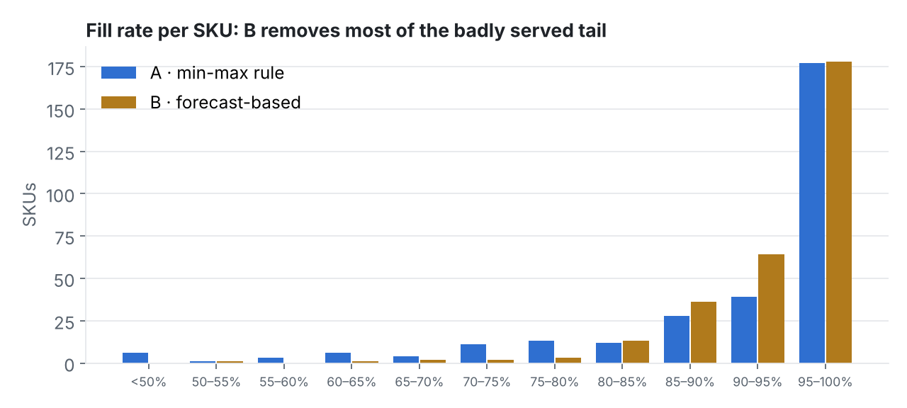
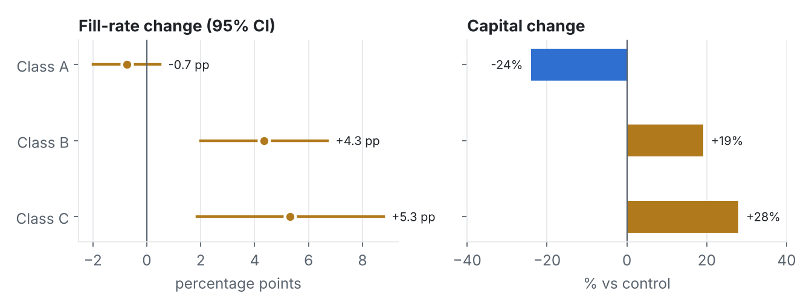

[English](README.md) · **Português**

# Teste A/B: duas políticas de reposição para um catálogo de OPME

Uma política de reposição baseada em previsão atende melhor os hospitais do que a regra de mínimo e máximo que a maioria das distribuidoras ainda usa, sem prender mais dinheiro em estoque? Montei o teste do jeito que eu rodaria numa distribuidora de OPME de verdade: sorteio dos SKUs, métricas fixadas antes de olhar o resultado, um teste A/A para checar o próprio pipeline e mais de um teste estatístico na leitura.

> **Os dados são sintéticos.** Catálogo e demanda são gerados com semente fixa, então qualquer pessoa reproduz os números abaixo. O formato da demanda imita o de distribuidoras de implantes: a maioria dos itens vende poucas vezes por mês, em lotes irregulares. Nenhum dado de cliente foi usado.

## A pergunta, em termos de negócio

A distribuidora tem 600 SKUs. Hoje todo item segue uma **regra de mínimo e máximo** (política A): quando estoque mais pedidos em aberto cai até o mínimo, compra-se até o dobro do mínimo. O mínimo foi definido uma vez, pela média histórica.

A proposta é uma **política de nível-alvo com previsão** (política B): revisão semanal de cada item, previsão por Croston-SBA (feito para demanda intermitente) e pedido até o nível que cobre o lead time mais uma semana no nível de serviço alvo (95% para itens A e B, 90% para C).

A regra de decisão foi escrita antes de rodar:

| Papel | Métrica | Condição |
|---|---|---|
| Principal | Fill rate por SKU (unidades atendidas / demandadas) | B melhor que A, IC 95% acima de zero |
| Guardrail | Capital médio parado em estoque | B no máximo 10% acima de A (limite superior do IC ≤ 1,10) |
| Secundárias | Pedidos emitidos, dias em ruptura | Reportadas com correção de Holm |
| Efeito mínimo que justifica mudar | | +3 pontos percentuais de fill rate |

## Desenho

- **Unidade de sorteio:** o SKU. 600 SKUs, 300 para cada braço, estratificados por classe ABC para os dois lados terem o mesmo mix (A 194, B 178, C 228).
- **Linha do tempo:** 90 dias de pré-período com todos na política A (os 30 primeiros descartados como aquecimento), depois 182 dias de teste.
- **Demanda:** ocorrência diária Bernoulli × tamanho de lote gama. Pela classificação de Syntetos-Boylan, o catálogo tem 309 SKUs intermitentes, 276 irregulares (lumpy), 8 erráticos e 7 suaves. Demanda não atendida é perdida (o hospital compra do concorrente).
- **Tamanho da amostra:** o efeito de 3 pp com desvio-padrão de 0,10 pede 181 SKUs por braço para 80% de poder a 5% de significância. O teste tem 300.
- **Checagem do pipeline (teste A/A):** 200 rodadas com os dois braços na política A. Um pipeline correto acusa uns 5% delas como significativas por acaso. Observado: **3,5%**.

## Resultados

| | A · mín-máx | B · previsão | Diferença (IC 95%) | p |
|---|---|---|---|---|
| Fill rate, média por SKU | 91,5% | 94,6% | **+3,1 pp** (+1,4 a +4,7) | 0,0002 |
| Idem, com CUPED | | | **+3,2 pp** (+1,7 a +4,8) | 0,00006 |
| Capital em estoque, média por SKU | R$ 39,4 mil | R$ 33,4 mil | razão **0,85** (0,67 a 1,08) | guardrail ok |
| Pedidos por SKU (6 meses) | 8,5 | 14,3 | +5,9 (+5,0 a +6,7) | < 0,001 (Holm) |
| Dias em ruptura por SKU | 2,6 | 2,3 | −0,3 (−0,8 a +0,1) | 0,16 (Holm) |
| Fill rate ponderado por unidades | 95,2% | 95,5% | +0,3 pp | |

O ganho em fill rate se mantém em todos os testes: intervalo t de Welch, bootstrap percentil (+1,4 a +4,7 pp) e teste de permutação (p = 0,0004). O CUPED, usando o fill rate de cada SKU no pré-período como covariável, reduziu a variância em 7,6% e estreitou um pouco o intervalo.



## O que os números dizem de fato

**O ganho está na cauda, não no SKU típico.** O Mann-Whitney não acha mudança na mediana (p = 0,74): a maior parte dos itens já passava de 95% nas duas políticas. O que a política B faz é puxar para cima os SKUs mal atendidos. Na A, 44 dos 300 SKUs ficaram abaixo de 80% de fill rate (6 deles abaixo de 50%); na B, 9 (nenhum abaixo de 50%).

**A média por SKU e a média por unidade contam histórias diferentes.** Ponderado por unidades, o ganho é de só 0,3 pp, porque poucos itens de giro alto concentram o volume e eles já iam bem. Se o negócio liga para "quantos hospitais ouviram não", vale a visão por SKU. Se liga para receita atendida, o ganho é pequeno. Dizer qual das duas se otimiza faz parte da análise.

**A política B redistribui dinheiro entre classes.** Esse recorte não foi pré-registrado, então é pista, não conclusão:



Itens classe A ficam com 24% menos capital e perdem 0,7 pp de fill rate (o IC inclui zero). Itens B e C recebem 19% e 28% mais capital e ganham 4,3 e 5,3 pp. O capital total ainda cai, porque é nos itens A que está o dinheiro.

**Tem um custo que o guardrail não enxerga.** A política B emite 69% mais pedidos. Se cada pedido de compra tem custo de processamento ou frete, isso precisa entrar na decisão.

## Recomendação

Adotar a política B para itens B e C, onde ela melhora o serviço com clareza. Para itens A, rodar um teste de acompanhamento com nível de serviço maior (z = 1,88, uns 97%) antes de trocar, porque a configuração atual troca um pouco de serviço por muito capital e o intervalo não descarta uma perda de 2 pp. Incluir o custo de pedido no guardrail da próxima versão.

## Limitações

- Dados sintéticos. Lead times reais variam, fornecedores têm lote mínimo e hospitais às vezes aceitam um substituto; nada disso está no modelo.
- Na vida real os SKUs dividem armazém e tempo do comprador, então sortear por SKU pode vazar efeito entre braços (interferência). Aqui eles são independentes por construção.
- Uma semente só para o resultado principal. As rodadas A/A mostram que o pipeline está calibrado, não que esse tamanho de efeito se repetiria exatamente.

## Reproduzir

```bash
pip install -e ".[dev]"
python -m abrep.experiment   # gera results/results.json (uns 10 s)
python -m abrep.report       # gera os dois gráficos em figures/
pytest -q                    # 7 testes: balanço de estoque, determinismo, Holm, CUPED, tamanho de amostra
```

Feito por [Gabriel Cunha](https://gorc-supply.github.io/) · Python, NumPy, SciPy, Matplotlib
